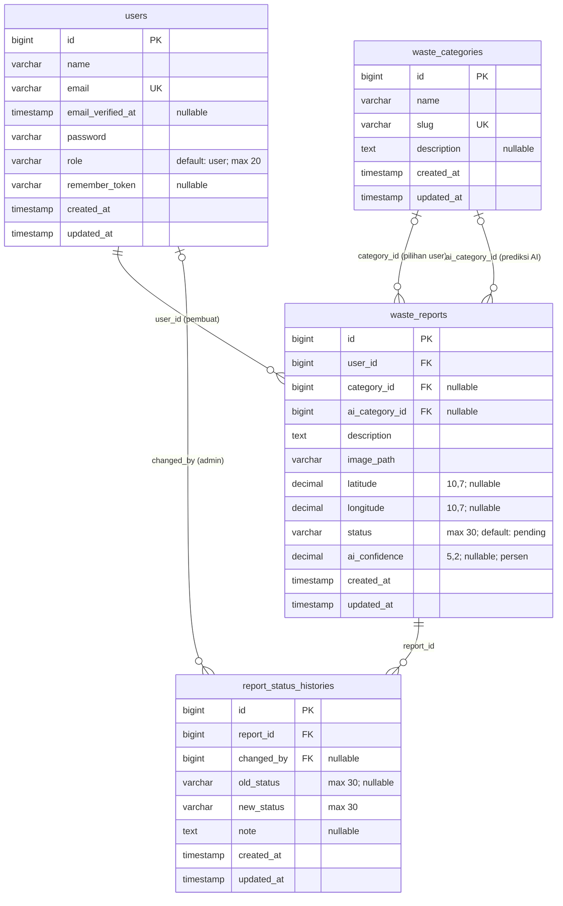
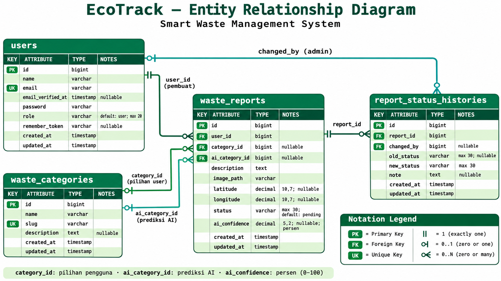

# Entity Relationship Diagram (ERD) — EcoTrack Smart Waste Management

> **Sumber utama:** delapan file Laravel migration pada `database/migrations` di branch `main` repository [Riowayy/smart-waste-management](https://github.com/Riowayy/smart-waste-management/tree/main/database/migrations), diperiksa pada 6 November 2026. Diagram ini mendokumentasikan **skema yang didefinisikan migration**, bukan hasil introspeksi langsung database production.

## 1. ERD domain utama

Diagram berikut berfokus pada empat tabel bisnis EcoTrack, termasuk kedua peran kategori (`category_id` dari pengguna dan `ai_category_id` dari model) dan riwayat status.

### Relasi dan aturan referensial

| Kolom sumber (foreign key) | Mengacu ke | Kardinalitas | Ketika parent dihapus |
|---|---|---|---|
| `waste_reports.user_id` | `users.id` | Satu user memiliki 0..banyak laporan; setiap laporan wajib punya pembuat | **CASCADE** (laporan terhapus) |
| `waste_reports.category_id` | `waste_categories.id` | Satu kategori dipakai 0..banyak laporan; sebuah laporan dapat tidak memiliki kategori | **SET NULL** |
| `waste_reports.ai_category_id` | `waste_categories.id` | Satu kategori AI dipakai 0..banyak laporan; prediksi dapat kosong | **SET NULL** |
| `report_status_histories.report_id` | `waste_reports.id` | Satu laporan memiliki 0..banyak riwayat; tiap riwayat wajib punya laporan | **CASCADE** |
| `report_status_histories.changed_by` | `users.id` | Satu user dapat mengubah 0..banyak riwayat; petugas pengubah dapat kosong | **SET NULL** |

> **Penting:** `category_id` adalah kategori laporan yang dipilih/dikonfirmasi pengguna; `ai_category_id` adalah kategori yang diprediksi model. Keduanya mengacu ke **tabel yang sama** (`waste_categories`) dan bukan tabel AI terpisah. `ai_confidence` menyimpan persen `0–100` (bukan probabilitas `0–1`). Lokasi foto disimpan sebagai **path string** (`image_path`), bukan BLOB. Nilai `role`, `status`, atau label kategori bukan tabel terpisah di migration.

## 2. Tabel infrastruktur Laravel

Selain empat tabel domain utama, migration membuat delapan tabel pendukung berikut. Tabel-tabel ini tetap bagian dari skema database, tetapi sengaja dipisah agar ERD domain tidak terlalu padat.

| Tabel | Primary key | Kolom penting / kegunaan | Hubungan database |
|---|---|---|---|
| `password_reset_tokens` | `email` (string) | `token`, `created_at` (nullable) | Tidak memiliki foreign key ke `users` |
| `sessions` | `id` (string) | `user_id` (nullable, indexed), `ip_address`, `user_agent`, `payload`, `last_activity` | `user_id` **bukan foreign key** yang dikonstrain migration |
| `cache` | `key` (string) | `value`, `expiration` (indexed) | Tidak ada foreign key |
| `cache_locks` | `key` (string) | `owner`, `expiration` (indexed) | Tidak ada foreign key |
| `jobs` | `id` | `queue`, `payload`, `attempts`, `reserved_at`, `available_at`, `created_at` | Tidak ada foreign key |
| `job_batches` | `id` (string) | `name`, jumlah pekerjaan, `failed_job_ids`, `options`, waktu proses | Tidak ada foreign key |
| `failed_jobs` | `id` | `uuid` (unique), `connection`, `queue`, `payload`, `exception`, `failed_at` | Tidak ada foreign key |
| `personal_access_tokens` | `id` | `tokenable_type` + `tokenable_id` (polymorphic), `token` (unique), `name`, `abilities`, `last_used_at`, `expires_at`, timestamps | Relasi **polymorphic pada aplikasi**, **tidak** memiliki foreign key fisik ke `users` |

`personal_access_tokens` dipakai Laravel Sanctum; `sessions` menyimpan sesi website; `cache`/`cache_locks` untuk cache; dan tabel `jobs` untuk antrean. **Jangan menggambar foreign key fisik yang tidak dinyatakan dalam migration.**

## 3. Catatan implementasi dan batasan

- Migration membuat **12 tabel** keseluruhan: 4 domain utama dan 8 tabel pendukung.
- `waste_reports.status` secara skema adalah string (bukan enum SQL); aturan status berlaku pada aplikasi.
- `waste_reports.image_path` hanya menyimpan alamat berkas; penyimpanan foto dilakukan di filesystem/storage, bukan di tabel `images`.
- Tidak ada tabel `ml_predictions`, `notifications`, `locations`, atau `roles` pada migration yang ditinjau.
- `waste_reports` memiliki index gabungan `(status, created_at)`; `report_status_histories` memiliki index `(report_id, created_at)`.
- ERD ini mengikuti migration di repository. Bila database Railway pernah dimodifikasi secara manual di luar migration, perbedaan tersebut harus diperiksa terpisah.

## 4. Referensi kode

- [Seluruh Laravel migrations](https://github.com/Riowayy/smart-waste-management/tree/main/database/migrations)
- [Dokumentasi REST API](https://github.com/Riowayy/smart-waste-management/blob/main/docs/API.md)
- [README EcoTrack](https://github.com/Riowayy/smart-waste-management/blob/main/README.md)

Untuk keperluan technical assessment, render blok `mermaid` pada Bagian 1 menjadi SVG atau PNG dengan nama `ERD_EcoTrack.png`; simpan file ini sebagai `docs/ERD.md` dalam repository agar GitHub merender diagram secara otomatis.

## Visualisasi Entity Relationship Diagram

