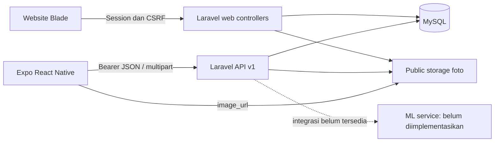

# Audit sistem EcoTrack — 4 November 2026

## Kesimpulan dan batas bukti

Audit source dan perbaikan aman dilakukan pada working tree yang telah berisi perubahan TASK 001–004. Tidak ada commit/push, perubahan schema, reset database, atau penghapusan data bisnis. Tidak ditemukan bukti P0 pada bagian yang diperiksa. Ini bukan jaminan keamanan menyeluruh. Definition of Done belum sepenuhnya terpenuhi: E2E mobile–server melalui jaringan, perangkat native, serta inference AI belum dibuktikan.

Rencana pelaksanaan: inventarisasi source/kontrak → baseline test dan audit dependency → perbaikan terukur → regresi → handoff. PHASE A dan remediasi terpilih PHASE B selesai; keterbatasan verifikasi dijelaskan di bawah. Basis test memakai SQLite `:memory:` dari phpunit.xml dan storage pengujian; konfigurasi testing tidak diubah.

## Arsitektur aktual

Backend Laravel 13, Sanctum 4, PHP CLI 8.5.12; Blade + Tailwind v4/Vite untuk website; Expo SDK 58, React 19.3, React Native 0.88.1, TypeScript 6.0.3 untuk mobile. MySQL untuk aplikasi lokal, SQLite untuk test. Controller menggunakan Eloquent langsung; tidak ada kebutuhan menambah lapisan service generik. Tidak ditemukan workflow Jobs/Events bisnis atau REST client ML.

Domain: User hasMany WasteReport; WasteReport belongsTo user/category/aiCategory dan hasMany statusHistories; history belongsTo report/changedBy. FK kategori/actor nullable, FK report/history cascade, email dan slug kategori unik, token hash unik. Index status+created_at dan report_id+created_at tersedia. Query daftar eager-load kategori, detail eager-load history/actor, dashboard memakai agregasi SQL dan limit lima. Tidak terlihat N+1 pada jalur tersebut. Index user_id+created_at dapat dipertimbangkan setelah EXPLAIN MySQL; tidak dibuat tanpa bukti performa.

Website memakai controller web dan redirect/view, bukan konsumen REST JSON. Keduanya berbagi model/domain dan enum status, tetapi validasi deskripsi/GPS memang berbeda. Tidak ada redesign website.

## Inventaris endpoint API

Prefix `/api/v1`. Semua error API memakai envelope `success:false,message,data:null,errors`; exception internal 500 disembunyikan. Sukses memakai `success:true,message,data`, daftar menambah pagination. Semua route privat memakai `auth:sanctum,role:user`; admin ditolak. Route autentikasi publik memakai throttle 10/menit per email+IP. Detail kontrak dan contoh tersedia di [API.md](API.md).

| Method/URI | Input dan validasi | Operasi/ownership | Respons/status | Verifikasi |
|---|---|---|---|---|
| POST auth/register | name/email ≤255, email unik, password 8–255 confirmed | INSERT user role server=user, token hashed Sanctum | user/token/type, 201; 422/429 | feature test |
| POST auth/login | email valid ≤255, password string ≤255 | baca user, Hash::check, INSERT token | user/token/type 200; 401/403/422/429 | feature test |
| POST auth/logout | Bearer | DELETE token aktif saja | null 200; 401/403 | feature test termasuk token dicabut |
| GET auth/me | Bearer | user token | id/name/email/role 200; 401/403 | kontrak tersedia; sesi dites unit |
| GET dashboard | Bearer | agregasi laporan user dan lima terbaru | statistics/recent_reports 200 | feature+unit |
| GET categories | Bearer | SELECT seluruh kategori urut nama | array kategori 200 | feature+unit |
| GET reports | page integer 1–1.000.000; per_page 1–50; status enum | SELECT hanya milik user, created_at/id DESC | array+pagination 200; 422 | feature; mobile kini terhubung |
| POST reports | description ≤10.000; image JPEG/PNG/WebP ≤5 MB; category exists nullable; koordinat numeric/range nullable | file public, INSERT dalam transaksi; owner token; status pending; cleanup saat DB gagal | resource 201; 422/500 | test PNG, ownership, status, file invalid |
| GET reports/{report} | ID numerik | query relasi user, kategori/history/actor | resource+history 200; 404 lintas owner | feature; mobile kini terhubung |

Tidak ada endpoint prediksi, perubahan status mobile, update/delete laporan mobile, atau reset password. Tabel reset token sendiri tidak berarti fitur reset sudah tersedia. Register membocorkan keberadaan email melalui validasi unique (tradeoff UX yang belum diubah). Tidak ditemukan endpoint API duplikat.

Website: GET/POST login (`guest`, POST throttle 5/menit); POST logout (`auth`); GET `/admin`, `/admin/settings`; CRUD `/admin/users`, CRUD kategori (tanpa show), CRUD `/admin/reports` dan PATCH status (semuanya `auth,role:admin`); GET `/dashboard`, GET list/create/detail laporan dan POST `/dashboard/reports` (`auth,role:user`). Form Requests admin memvalidasi role/email/password/status/category/file; perubahan status memakai lockForUpdate dan history dalam transaksi yang sama. Website user deskripsi ≤1.000 dan GPS wajib. GET root mengarahkan sesuai session. `route:list --except-vendor` menghasilkan 41 route.

## Matriks enam kebutuhan recruiter

| Kebutuhan | Implementasi dan bukti | Status/keterbatasan |
|---|---|---|
| Register/login | Sanctum token, SecureStore native, token web hanya memori, protected Stack, logout revoke; feature/unit tests | tersedia; belum E2E seluruh perangkat |
| Dashboard | data database per user, lima terbaru, refresh/error/retry/empty; feature/unit tests | tersedia |
| Membuat laporan | multipart client terpusat, image picker, permission GPS, owner/status server; test PNG dan byte storage | tersedia; upload jaringan nyata dari mobile belum dibuktikan |
| Riwayat/status | API ownership/pagination/history sudah ada; placeholder mobile diganti riwayat/detail/filter | source+type/export lulus; interaksi riwayat belum E2E |
| API integration | JSON/Bearer/multipart/errors/timeout/cancel; 28 unit tests dan API feature tests | belum validasi jaringan LAN/CORS/file URL dari perangkat |
| AI image detection | kolom nullable ai_category_id/ai_confidence saja | belum siap; folder ml-service kosong, tidak ada inference |

## Temuan dan remediasi

| ID/severity | Lokasi bukti | Dampak/risiko | Tindakan/status |
|---|---|---|---|
| S01 P1 | app/Http/Controllers/Admin/UserController.php:106–112 | token yang telah bocor tetap dapat digunakan setelah password diganti | revoke semua token pada perubahan password/role di transaksi yang sama; regression test |
| S02 P2 | app/Providers/AppServiceProvider.php:26,33 | email array diproses limiter sebelum FormRequest, konversi string berpotensi 500 | guard is_string; test 422 |
| S03 P2 | bootstrap/app.php bagian response exception | envelope membuang Retry-After milik throttle | teruskan header HttpException; test 429+header |
| S04 P2 | app/Http/Controllers/Api/V1/WasteReportController.php:23,32 | page tidak tervalidasi; tie timestamp tidak deterministik | page bounded integer dan secondary id DESC; test invalid page |
| S05 P2 | mobile/src/features/reporting/service.ts:17–20 dan screen.tsx | batas 1.000/GPS wajib menolak input yang sah menurut API; copy izin kontradiktif | selaraskan 10.000/GPS opsional; test batas dan omission |
| S06 P1 fungsional | mobile/src/app/reports.tsx sebelumnya placeholder | pengguna tidak bisa melihat riwayat lengkap/detail | hubungkan history.tsx ke API, termasuk abort/error/retry/empty/filter/pagination |
| S07 P2 | app/Http/Controllers/Admin/WasteReportController.php:58,109 | filesystem return false bisa diteruskan sebagai path saat create/update | hentikan sebelum mutasi DB; suite website lulus |
| S08 P2 | mobile/package.json dan lockfile | tujuh mismatch SDK | versi patch/minor kompatibel dipasang; check+Doctor lulus |
| S09 P2 terbuka | config/sanctum.php:expiration; AuthController createToken | token tidak kedaluwarsa otomatis; login dapat menambah token terus-menerus | perlu kebijakan TTL/pruning; tidak mengubah konfigurasi produksi |
| S10 P2 terbuka | config/filesystems.php public; WasteReportResource image_url | siapa pun yang memiliki URL dapat membaca foto, meski API detail menjaga ownership | keputusan privasi diperlukan sebelum private storage/signed URL |
| S11 P2 terbuka | POST reports dan reporting/screen.tsx uncertain | client lock tidak mencegah duplikat lintas restart atau client lain | perlu rancangan idempotency key dengan uniqueness atomik dan retensi; tidak mengubah schema |
| S12 P2 terbuka | mobile transitive glob/minimatch | risiko DoS tooling, lima package terdampak audit | patch aman belum ditawarkan dalam SDK; jangan downgrade/force major |

Pengamanan yang sudah benar: password hashed cast, role registrasi server, input tervalidasi bukan request all, query terparameterisasi, Blade escaping (raw yang ditemukan hanya literal pagination), generated storage filename, MIME/image allowlist tanpa SVG/executable, max5MB, role middleware, query ownership, status history atomik, session regenerate/invalidate dan CSRF web. Test skrip bernama jpg memakai UploadedFile nyata: MIME tidak dipercaya dari nama/header.

Konfigurasi lokal dibaca hanya sebagai ringkasan aman: environment local, debug true, storage link ada. Ini sesuai dev dan bukan temuan produksi. Hanya .env.example terlacak Git. Tidak ada secret dicetak. CORS/trusted proxy/security headers produksi belum diverifikasi; tidak diklaim aman karena konfigurasi edge tidak tersedia. Sanctum bearer tidak menggunakan cookie di API client (`credentials:omit`, `redirect:error`). Foto public harus dilayani tanpa eksekusi skrip oleh web server. MIME bukan antivirus atau jaminan tidak ada metadata sensitif. Penggantian file paralel dan kegagalan delete berpotensi orphan file; belum diuji fault/concurrency MySQL.

## Dependency

Composer audit: tidak ada advisory/abandoned. Composer lock dipertahankan; framework tidak diganti. npm website: nol advisory. Audit mobile awal delapan moderate, akhir lima moderate (nol high/critical).

| Package | Installed awal → akhir | Recommended | Usage | Severity | Action |
|---|---|---|---|---|---|
| @expo/ui | 58.0.26 → 58.0.27 | ~58.0.27 | library UI SDK | P2 kompatibilitas | update patch |
| expo | 58.0.22 → 58.0.23 | ~58.0.23 | runtime/tooling | P2/moderate transitif | update patch |
| expo-constants | 58.0.14 → 58.0.15 | ~58.0.15 | konfigurasi SDK/router | P2 | update patch |
| expo-linking | 58.0.15 → 58.0.16 | ~58.0.16 | navigasi/deep link | P2 | update patch |
| expo-router | 58.0.29 → 58.0.30 | ~58.0.30 | routing | P2 | update patch |
| expo-splash-screen | 58.0.12 → 58.0.13 | ~58.0.13 | config plugin | P2 | update patch |
| react-native-safe-area-context | 5.10.1 → 5.11.1 | ~5.11.1 | SafeAreaView | P2 | update minor |
| glob | 13.0.6 | >14.0.1 menurut advisory | CLI/fingerprint | moderate | tahan major transitif |
| minimatch | 10.2.6 | ≥11.0.1 menurut advisory | glob/fingerprint | moderate | tahan major transitif |
| @expo/fingerprint | 0.21.9 | tunggu upstream kompatibel | tooling | moderate transitif | terbuka |
| @expo/cli | bawaan expo 58.0.23 | tunggu upstream kompatibel | CLI | moderate transitif | terbuka |

npm menawarkan expo 53.0.11 sebagai fix major; itu downgrade besar dari SDK58 dan sengaja tidak diterapkan. Tidak ada dependency dihapus atas dasar tidak ditemukan import saja karena kebutuhan transitive/plugin belum dapat dikesampingkan.

Sumber resmi: [Laravel Sanctum 13](https://laravel.com/docs/13.x/sanctum), [validasi Laravel](https://laravel.com/docs/13.x/validation#rule-mimes), [Expo SDK58](https://docs.expo.dev/versions/v58.0.0/), [ImagePicker SDK58](https://docs.expo.dev/versions/v58.0.0/sdk/imagepicker/), [React Native security](https://reactnative.dev/docs/security), [glob advisory](https://github.com/advisories/GHSA-3g3m-2fjr-6pw4), [minimatch advisory](https://github.com/advisories/GHSA-g3hv-75wg-m249). Kesesuaian versi juga diperiksa menggunakan tool SDK terpasang, bukan hanya ingatan/dokumentasi lama.

## Pengujian dan exit code

| Command/pemeriksaan | Exit awal → akhir | Hasil |
|---|---|---|
| php artisan test | 0 → 0 | baseline 77/537; final 83 test/567 assertion |
| php vendor/phpunit/phpunit/phpunit | 0 → 0 | baseline77; regresi82/564 |
| PHPUnit --debug --filter MobileApiTest | 0 | 13 test API |
| node --test tests/Unit/*.test.cjs | 0 → 0 | 28 test lulus |
| npx tsc --noEmit | 0 → 0 | lulus |
| npx expo install --check | 1 → 0 | tujuh mismatch diperbaiki |
| npx expo-doctor | 1 → 0 | 19/20 →20/20 |
| npx expo export --platform web --max-workers 1 | 0 → 0 | selesai normal, kegagalan lama tidak tereproduksi |
| npx expo install tujuh versi eksplisit | 0 | lockfile diperbarui |
| npm audit --json (mobile) | 1 →1 | 8 →5 moderate |
| npm audit --json (root) | 0 | bersih |
| composer audit --format=json | 0 | bersih |
| npm run build (root) | 0 | build lulus; warning resolusi font runtime |
| git diff --check | 0 | warning CRLF saja |
| Impeccable context/detect | 0 | scoped fix; detector [] |
| Playwright website open/click/goto/console | 0 | login render, form kosong tetap login, /admin redirect login, console tanpa error |
| Expo start port8082 | 1 | port sudah dipakai; bukan error aplikasi |

Percobaan pengembangan: PHPUnit pertama setelah menulis test baru exit1 karena BOM UTF8 PowerShell, diperbaiki tanpa mengubah konfigurasi. Percobaan berikut exit1 karena fixture UploadedFile::fake melaporkan MIME dari ekstensi; diganti UploadedFile nyata untuk menguji MIME isi dan final lulus. Probe php -r exit1 karena quoting shell, diganti stdin PHP dan exit0. Hal ini bukan kerentanan upload yang terbukti. Command gabungan inspeksi composer/rg berakhir1 karena satu path rg tidak ada; jangan dianggap hasil composer gagal.

Browser tidak menggunakan screenshot/video/coverage. Test PHPUnit memakai kernel HTTP Laravel dan disk test, bukan bukti upload lewat jaringan mobile atau MySQL produksi. Pengujian browser lengkap login/register/upload/GPS/history/logout belum selesai. Tidak tersedia perangkat native untuk membuktikan permission dan URI multipart Android/iOS. ESLint belum dijalankan karena paket/config lint belum terpasang; tidak menambahkan dependency tanpa kebutuhan. Static analysis PHP khusus tidak tersedia di composer.

## AI readiness dan langkah berikut

Belum ada model, preprocessing, inference endpoint, confidence nyata, timeout REST client, pemetaan label, atau UI hasil prediksi. Kolom DB bukan bukti AI berfungsi. Integrasi minimal: service terpisah dengan model terversi dan label Organic/Plastic/Paper yang teruji; POST /predict multipart dengan validasi ukuran/MIME; normalisasi orientasi/warna/resize mengikuti training; output label/confidence/model_version; Laravel client timeout terbatas dan validasi respons; kegagalan AI tidak membatalkan laporan dasar. Confidence DB memakai skala0–100, sehingga konversi kontrak perlu eksplisit. Simpan hanya hasil nyata; golden-image inference test wajib sebelum klaim siap.

Prioritas: (1) E2E terisolasi lintas mobile–Laravel termasuk akses foto, CORS, dan GPS perangkat, (2) TTL token/privasi foto/idempotensi dan fault injection, (3) pembaruan upstream moderate tanpa downgrade framework, (4) inference nyata. Jangan menggunakan database development untuk fixture permanen. Tidak diperlukan approval untuk perbaikan yang telah dilakukan; perubahan schema besar, contract website, dan konfigurasi produksi tetap membutuhkan keputusan pengguna.

## Berkas sesi audit

Diubah: app/Providers/AppServiceProvider.php; bootstrap/app.php; app/Http/Controllers/Api/V1/WasteReportController.php; app/Http/Controllers/Admin/UserController.php; app/Http/Controllers/Admin/WasteReportController.php; mobile/package.json; mobile/package-lock.json; mobile/src/features/reporting/service.ts; mobile/src/features/reporting/screen.tsx; mobile/src/app/reports.tsx; mobile/tests/Unit/reporting.test.cjs; docs/API.md; docs/CODEX_HANDOFF.md; mobile/instrucktor/handoff.md (ignored). Baru: mobile/src/features/reporting/history.tsx; tests/Feature/Api/V1/HardeningTest.php; docs/SYSTEM_AUDIT.md. Berkas mobile feature sebelumnya untracked milik pengguna tetap dipertahankan.

Git awal: AGENTS, mobile/AGENTS, README, app.json, codex/skills, package/lock, layout/index sudah modified; route auth/report dan features/tests mobile sudah untracked. Tidak ada perubahan tersebut dibuang. Aturan enam skill pada agent sudah selaras secara substantif; tidak perlu menambah blok aturan duplikat.

Skill diterapkan: lean-code (reuse client/model/UI, tanpa service generik), planning (dua fase dan quality gates), project-context (source mengungguli handoff), design-taste-frontend (mode layar operasional, tanpa redesign), emil-design-eng (feedback/tombol/kejelasan), impeccable harden (loading/error/empty/retry dan detector), security-best-practices (bagian TypeScript; Laravel mengikuti dokumentasi resmi), testing-strategy (feature boundary terisolasi), systematic-debugging (export/fixture diperiksa dari reproduksi), playwright (smoke browser). Tidak memasang skill online baru.

| Before | After | Why |
|---|---|---|
| Placeholder riwayat | Daftar/detail API, filter dan pagination | Alur recruiter dapat diakses dari UI |
| Copy GPS wajib tetapi error menyarankan tanpa GPS | GPS opsional sesuai API | Hilangkan instruksi yang saling bertentangan |
| Deskripsi client1.000, API10.000 | Client10.000 | Konsistensi kontrak tanpa mengubah backend website |

Verifikasi akhir: `php artisan test` lulus 83 test/567 assertion, exit0; tambahan test storage admin gagal tidak membuat laporan. `composer validate --no-check-publish` dan `composer check-platform-reqs` masing-masing exit0. Playwright Expo Web pada port8094 membuktikan login tampil, form kosong menampilkan error Indonesia, route `/reports` tanpa sesi kembali ke login, console tanpa error (exit0). Browser port8082 timeout meski wrapper CLI mengembalikan exit0; tidak dinilai lulus. Probe browser lengkap dengan akun/upload belum dilakukan. Server Expo sementara port8094 dihentikan setelah pemeriksaan; server pengguna tidak disentuh.
